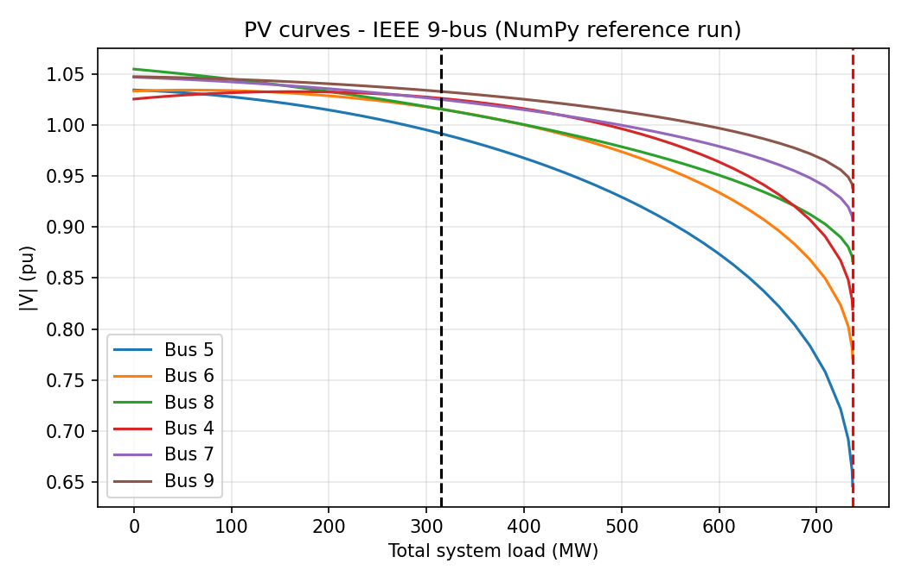
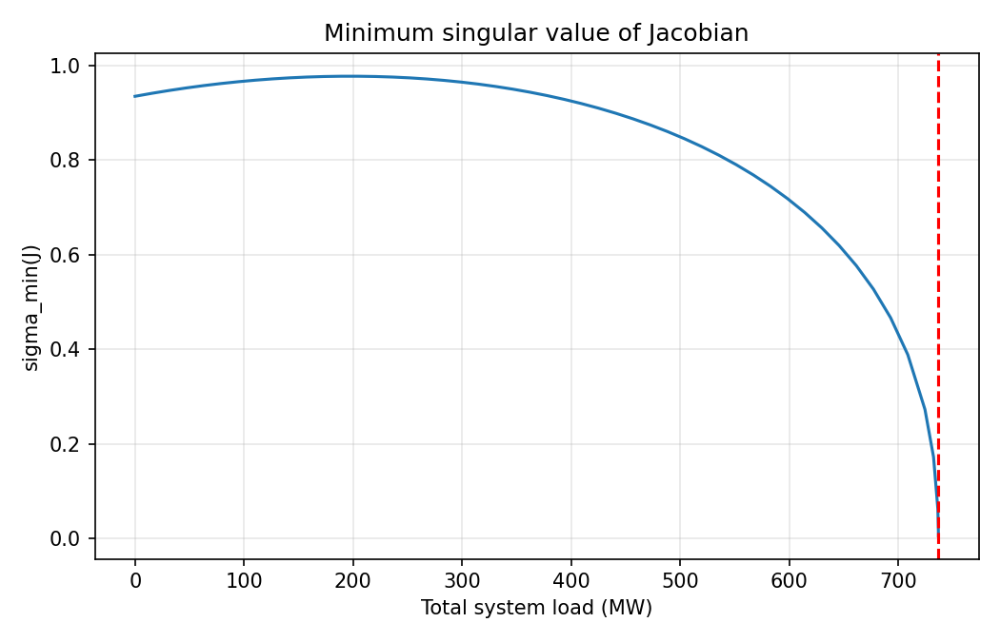

# Load Flow & Voltage Stability Analysis (IEEE 9-Bus)

Steady-state **Newton-Raphson load flow** and **PV (nose) curve** voltage-stability study on the IEEE 9-bus (WSCC) system, implemented in MATLAB.

## Features
- Y-bus formulation with line charging
- Newton-Raphson solver in polar form with an analytic Jacobian (J11, J12, J21, J22)
- Bus voltages and angles, generation, line flows and total losses
- Stressed loading: all loads scaled at constant power factor; PV-bus generation fixed, slack bus picks up the rest
- PV curves for all load/transit buses, with the collapse point refined by step halving
- Minimum singular value of the Jacobian tracked as a voltage-collapse indicator

## Repository layout
```
src/load_flow_voltage_stability.m   Main MATLAB script (run this)
python/validate.py                  Independent NumPy cross-check
results/                            Output figures
LICENSE
```

## How to run
**MATLAB** (R2016b or later; no toolboxes needed)
```matlab
cd src
load_flow_voltage_stability
```
The script prints the load-flow tables and saves figures to `results/`.

**Python cross-check** (optional)
```bash
pip install numpy matplotlib
python python/validate.py
```

## Results (base case, 100 MVA base)
| Bus | \|V\| (pu) | Angle (deg) |
|----|-----------|-------------|
| 1 | 1.0400 | 0.000 |
| 2 | 1.0250 | 9.290 |
| 3 | 1.0250 | 4.701 |
| 4 | 1.0260 | -2.220 |
| 5 | 0.9915 | -4.027 |
| 6 | 1.0155 | -3.620 |
| 7 | 1.0249 | 3.725 |
| 8 | 1.0156 | 0.744 |
| 9 | 1.0327 | 2.004 |

Converges in 4 iterations (tolerance 1e-8 pu).

**Voltage stability:** critical loading factor about 2.34x base load (about 737 MW against 315 MW base). Bus 5 is the weakest bus.




> The plots above come from the NumPy reference implementation (`python/validate.py`). Running the MATLAB script writes `pv_curves_matlab.png` and `jacobian_sigma_matlab.png` to the same folder.

## Method notes
- Mismatch equations: ΔP = P_sch − P_calc at PV and PQ buses, ΔQ = Q_sch − Q_calc at PQ buses.
- Loading model: P_d(λ) = λ·P_d0, Q_d(λ) = λ·Q_d0.
- Only the upper branch of the PV curve is traced (the solver stops at the nose). A continuation power flow would trace the lower branch too.

## Data source
Standard WSCC 3-machine, 9-bus test system (Anderson & Fouad).

## License
MIT
